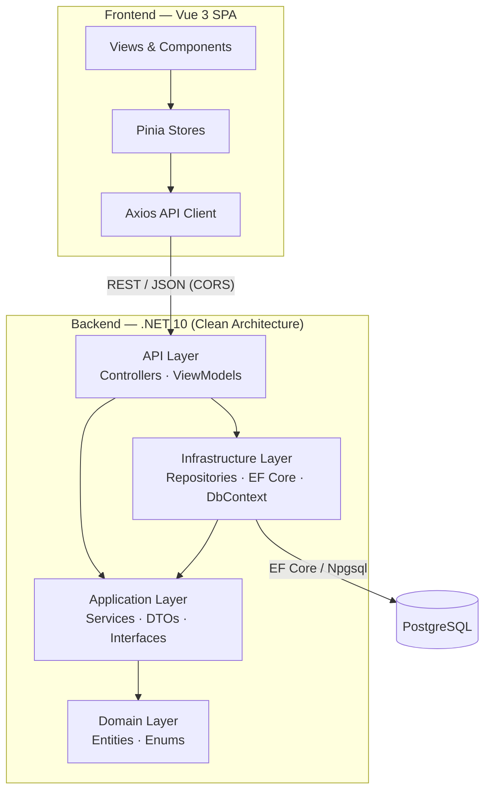

# Tasky

Tasky is a task and board management app built around Kanban and list boards. Users create boards, add tasks, assign responsibles, track status and estimates, and reorder items. It's split into a **.NET 10 Web API** backend following Clean Architecture and a **Vue 3 + Vite** single-page frontend, backed by **PostgreSQL** via EF Core.

## Tech Stack

**Backend** — ASP.NET Core Web API (.NET 10), Entity Framework Core 10, Npgsql (PostgreSQL), Swashbuckle/Swagger, Clean Architecture (Domain / Application / Infrastructure / API).

**Frontend** — Vue 3, Vite, TypeScript, Pinia, Vue Router, Tailwind CSS, Axios, Vitest. API types are generated from the backend's OpenAPI schema via `openapi-typescript`.

**Infrastructure** — Docker Compose (PostgreSQL 18 + API container).

## Repository Structure

```
Tasky/
├── Tasky/                          # .NET solution (backend)
│   ├── Tasky.Domain/               # Entities & enums — no dependencies
│   │   ├── Entities/               # BoardEntity, TaskEntity, UserEntity
│   │   └── Enums/                  # BoardType, Status
│   ├── Tasky.Application/          # Business logic & contracts
│   │   ├── Interfaces/             # Service & repository interfaces
│   │   ├── Services/               # BoardsService, TaskService, UserService
│   │   ├── Model/                  # DTOs
│   │   └── Mappers/
│   ├── Tasky.Infrastructure/       # EF Core, repositories, DB context
│   │   ├── Persistance/            # BoardDbContext
│   │   ├── Implementation/         # Repository implementations
│   │   └── Migrations/
│   ├── Tasky.API/                  # Controllers, DI, HTTP entry point
│   │   ├── Controllers/            # Board, Task, User
│   │   ├── ViewModels/
│   │   └── Program.cs
│   └── docker-compose.yml          # PostgreSQL + API
│
└── tasky-frontend/                 # Vue 3 SPA
    └── src/
        ├── api/                    # Axios client + generated schema
        ├── components/             # Reusable UI (boards, sidebar, icons)
        ├── views/                  # Login, board list, board screens
        ├── stores/                 # Pinia stores (board, user)
        ├── router/
        └── types/
```

## Architecture

The backend follows Clean Architecture: dependencies point inward, with `Domain` at the center and `API` at the edge. The Vue SPA talks to the API over REST (CORS-enabled), and the API persists to PostgreSQL through EF Core.



## Getting Started

**Prerequisites:** .NET 10 SDK, Node.js 22+, Docker.

Run the database and API with Docker Compose:

```sh
cd Tasky
docker compose up --build
```

The API is exposed on `http://localhost:6060` (Swagger UI at `/swagger` in Development).

Run the frontend:

```sh
cd tasky-frontend
npm install
npm run dev
```

The dev server runs on `http://localhost:5173`. To regenerate API types from the running backend:

```sh
npm run generate:api
```

## API Overview

| Resource | Route            | Description                          |
|----------|------------------|--------------------------------------|
| Boards   | `/api/board`     | List boards for a user, create board |
| Tasks    | `/api/task`      | List tasks for a board, add task     |
| Users    | `/api/user`      | User management                      |
```

